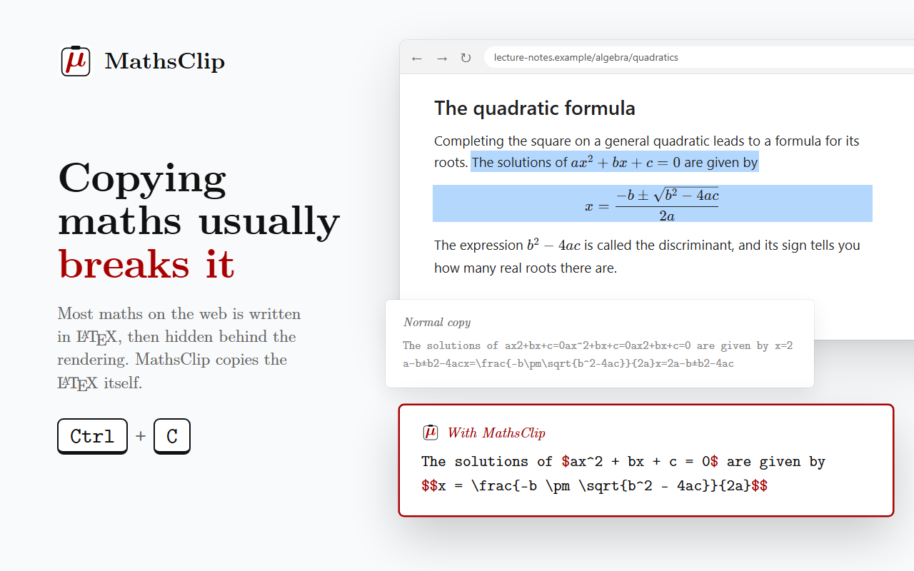

# MathsClip

A Chrome extension that copies maths from web pages as LaTeX.

Copy an equation from Wikipedia or a ChatGPT answer and you normally get a jumble of symbols, often with each one on its own line. MathsClip gives you the LaTeX source instead, ready to paste into Overleaf, Obsidian or your notes.

<!-- TODO: add an "Add to Chrome" link here once the store listing is live -->



## How to use it

- **Copy as usual.** Select some text with maths in it and press Ctrl+C (Cmd+C on a Mac). Each equation becomes `$...$`, or `$$...$$` for display maths. The rest of the text is untouched, and so is anything you copy that has no maths in it.
- **Right-click an equation** and choose **Copy Equation as LaTeX**. There's no need to select it first.
- **Click to copy.** Turn this on in the settings, then hover over an equation and click it.

For example, copying a sentence about the quadratic formula gives you something like:

```
The solutions are $x = \frac{-b \pm \sqrt{b^2 - 4ac}}{2a}$, where $a \neq 0$.
```

If your selection only covers part of an equation, the whole equation is copied rather than a broken piece of it.

In the settings you can also choose:

- **Plain text or Markdown.** Plain text keeps headings, bold and links when you paste into Google Docs, Word or Gmail. Markdown suits Obsidian or GitHub.
- **Delimiters:** `$...$` / `$$...$$` or `\(...\)` / `\[...\]`.
- **Single equations with or without delimiters.** By default the right-click and click options copy just the LaTeX, which is what Overleaf, Desmos and Word's LaTeX equation mode expect.
- **MathJax's menu.** MathJax sites have their own right-click menu. You can switch it off so Chrome's menu (and the copy option) appears instead.

## Where it works

| Maths on the page | For example |
|---|---|
| KaTeX | ChatGPT, Claude, the KaTeX docs |
| MathJax 2, 3 and 4 | Mathematics Stack Exchange, many university and course pages |
| Wikipedia | Any article with formulas |
| Google Search | AI Overviews |
| MathML | arXiv HTML papers |
| LaTeX images | WordPress blogs, CodeCogs images |

Pages that tag equations with `data-latex`, `data-tex` or `data-math` work too.

Found a page where it gets something wrong? [Open an issue](https://github.com/chubby1523/mathsclip/issues/new/choose) with the link.

## Privacy

MathsClip doesn't collect or send anything. Everything happens in your browser, and the only thing it stores is your settings, which Chrome syncs between your devices if you're signed in. Full details in [PRIVACY.md](PRIVACY.md).

## Contributing

[CONTRIBUTING.md](CONTRIBUTING.md) covers running it from source, the tests and how releases are made. [ARCHITECTURE.md](ARCHITECTURE.md) explains how it works.

## Licence and credits

MIT, see [LICENSE](LICENSE). Inspired by the *Copy LaTeX (KaTeX & MathJax)* extension, though none of its code is used.

- The popup's fonts are Latin-only subsets of Computer Modern Unicode by Andrey V. Panov. They're renamed "MathsClip Serif" and "MathsClip Typewriter", as the [SIL Open Font License](src/fonts/OFL.txt) requires for modified versions.
- The μ in the icon comes from [Latin Modern Math](https://ctan.org/pkg/lm-math), under the GUST Font License.
